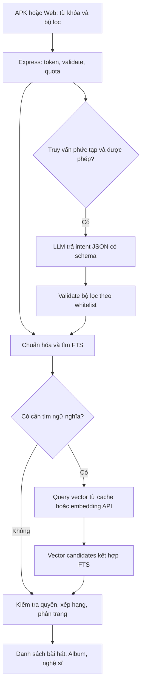

# Thiết kế AI cho Music Stream App

## Tiến độ hiện tại

- Tìm kiếm hybrid và index metadata tự cập nhật đã có. Suggestions for you và gợi ý tương tự dùng vector đã lưu, không inference mỗi lượt.
- **Lyric chạy trực tiếp trong form đăng bài:** audio được upload/xác minh, POST /audio-lyric trả text, điền vào ô Lời bài hát, người dùng sửa và nhấn Lưu mới ghi field songs.lyric. Không lưu draft, job hoặc nguồn ASR trong Firestore.
- Chỉ quota giây/ngày được ghi trong aiUsage; text tạm ở RAM của request và form. Đã bỏ lyricJobs/lyricUploadSources khỏi luồng code. Không tự xóa document cũ nếu cloud đã từng tạo chúng.
- Không có queue/polling/worker draft, không có editor AI sau khi đăng. Render restart/ngắt mạng có thể làm request mất kết quả; người dùng tạo lại nếu cần, không tự retry inference.
- ASR mặc định tắt; cần AI_ENABLED=true, AI_LYRICS_ENABLED=true, AI_TRANSCRIBE_MODEL=gemini-3.5-transcribe, AI_DAILY_AUDIO_SECONDS > 0 và GEMINI_API_KEY phía backend. Giới hạn demo 5 phút/bài; 600 giây/ngày là cấu hình demo đề nghị. Free Tier/quyền model vẫn cần xác minh thật, không tự bật trả phí.
- Log backend chỉ ghi stage/HTTP status/provider status whitelist khi lỗi; không ghi key, URL riêng tư, audio hoặc text nháp. Chưa xác định nguyên nhân lỗi ASR cloud trước đó vì bản cũ nuốt chi tiết lỗi.
- Kiểm thử local với provider giả lập đạt; chưa deploy bản sửa flow trực tiếp. LLM intent và Vertex không cần cho demo nhỏ, không thuộc phần phải triển khai tiếp.

## 1. Hướng chọn cho dự án này

Tiếp tục dùng backend Express trên Render làm lớp xác thực, kiểm soát quyền và gọi API AI. Giữ Firestore làm nguồn dữ liệu, Cloudinary giữ media. **Cloudinary là nhà cung cấp riêng, không thuộc Google Cloud.** Google Cloud/Firebase và Vertex có thể cùng project quản trị, nhưng điều đó không tự cấp quyền model hoặc miễn phí.

MVP nên đi theo thứ tự:

1. Tìm kiếm hiện tại bằng FTS, metadata và luật đơn giản vẫn hoạt động hoàn toàn khi tắt AI.
2. Tạo embedding cho nội dung công khai theo batch khi thêm/sửa bài; dùng vector cho truy vấn ngữ nghĩa và gợi ý tương tự. Đây không phải lời gọi mô hình sinh văn bản.
3. Chỉ gọi mô hình phân tích truy vấn khi người dùng chọn tìm thông minh hoặc truy vấn thực sự cần phân tích nhiều điều kiện. Kết quả là JSON có schema, không phải đoạn chat bắt buộc.
4. Audio → lyric là tác vụ riêng: tạo **bản nháp**, chủ sở hữu sửa và duyệt. Không dùng embedding để chép lời.
5. Chỉ chuyển adapter sang Vertex sau khi hoàn tất bảng kiểm quyền/model/region/quota ở mục 9.

## 2. Những gì code đã có và nơi nối thêm

| Nền tảng hiện tại                                 | Nguồn                                                                         | Thay đổi đề xuất                                                                       |
| ------------------------------------------------- | ----------------------------------------------------------------------------- | -------------------------------------------------------------------------------------- |
| Express backend, Docker, Render manifest          | `tools/backend/http-app.cjs`, `main.cjs`, `Dockerfile.backend`, `render.yaml` | Thêm adapter AI phía server, không tạo proxy thứ hai nếu chưa có nhu cầu               |
| SQLite FTS5 trong RAM, normalize tiếng Việt       | `tools/backend/search-index.cjs`                                              | Giữ đường tìm tên/từ khóa; thêm lớp hybrid rank độc lập                                |
| `/search` có query/kind/cursor và hydrate dữ liệu | `tools/backend/service.cjs`                                                   | Bổ sung mode opt-in, giữ contract cũ khi AI off                                        |
| Gợi ý từ genre/history/favorites/follow           | `src/utils/recommendations.ts`, `tools/backend/related-artists.cjs`           | Bổ sung độ tương tự vector vào điểm, không bỏ tín hiệu hiện tại                        |
| Audio đã xác minh owner/publicId/metadata         | `audio-assets.cjs`, `song-create.cjs`, `inspect-audio.cjs`                    | Job nhận songId, backend tự resolve media đã được phép                                 |
| Firestore `songs.lyric`, DTO client `Song.lyrics` | `song-create.cjs`, `dto.cjs`, `src/types/domain.ts`                           | Giữ mapping này; draft lyric nằm riêng, chỉ publish sau duyệt                          |
| Rule client hiện deny business data               | `firestore.rules`                                                             | Collection AI vẫn server-only; Admin SDK bỏ qua Rules nên endpoint phải kiểm tra quyền |
| Search, UploadSong, LyricsScreen                  | `src/screens/`                                                                | Tạo lời trực tiếp trong form đăng bài; sửa loading theo báo cáo trước                  |

Không thấy implementation embedding/vector/LLM/transcription trong các đường hiện tại. Đây là tính năng mới, không phải bật một biến môi trường là xong.

## 3. Có thể miễn phí đến đâu?

### Hạ tầng và model ứng viên

| Thành phần         | Lựa chọn đề nghị                                                                                                      | Điều đã kiểm tra từ tài liệu công khai                         | Chưa được xác nhận trong project                                                            |
| ------------------ | --------------------------------------------------------------------------------------------------------------------- | -------------------------------------------------------------- | ------------------------------------------------------------------------------------------- |
| Express API        | Giữ Render Free để demo                                                                                               | Chạy Web Service, có idle sleep và filesystem tạm              | Uptime/latency/RAM thực tế của service                                                      |
| Embedding mới      | Thử `gemini-embedding-2`, text-only trước                                                                             | Có model này; kích thước 768 là lựa chọn được tài liệu nêu     | API key/project có quota và gọi thành công từ Render                                        |
| Embedding thay thế | `gemini-embedding-001` nếu quyền/đánh giá phù hợp                                                                     | Hỗ trợ text và query/document task types                       | Quyền hiện tại; cần index riêng, không trộn với Embedding 2                                 |
| Phân tích truy vấn | Một model Flash/Flash-Lite có structured output và còn quota, ví dụ `gemini-2.5-flash-lite` là ứng viên cần preflight | Pricing công khai có free tier cho ứng viên                    | Model còn được cấp, schema đạt yêu cầu và chất lượng tiếng Việt                             |
| Chép audio         | Thử `gemini-3.5-transcribe` trên tập mẫu ngắn                                                                         | Có model chuyên transcription                                  | Chất lượng lời **hát**, quota, quyền và latency                                             |
| Vertex             | Adapter thay thế sau                                                                                                  | Có danh sách model và endpoint theo location                   | Billing/IAM/API/quota/model tại location của dự án                                          |
| Chạy local         | Batch embedding/ASR trên máy phát triển nếu cần                                                                       | Phương án kiến trúc, không phát sinh phí API từ thao tác local | Cần chọn model có giấy phép phù hợp và benchmark tài nguyên; không phải dịch vụ luôn online |

Nguồn model: [Gemini Embedding 2](https://ai.google.dev/gemini-api/docs/models/gemini-embedding-2), [Embeddings](https://ai.google.dev/gemini-api/docs/embeddings), [Transcription](https://ai.google.dev/gemini-api/docs/transcribe).

Pricing công khai tra cứu ngày lập tài liệu liệt kê free tier cho text input của Embedding 2, ứng viên Flash-Lite nêu trên và input/output của Transcribe. Bảng giá cũng phân biệt việc sử dụng dữ liệu giữa free/paid. Đây là **khả năng dùng miễn phí trong hạn mức**, không chứng minh tài khoản hiện tại đã được cấp quota. Không tự nâng sang paid khi hết quota. [Gemini API pricing](https://ai.google.dev/gemini-api/docs/pricing).

Quota phải đọc từ AI Studio của project; giới hạn theo project/model, không thể nhân hạn mức bằng nhiều API key. Không chép cố định một con số RPM/RPD trên mạng thành cam kết cho ứng dụng. [Rate limits](https://ai.google.dev/gemini-api/docs/rate-limits).

Render Free ngủ khi không có traffic trong 15 phút, filesystem không bền qua restart/sleep và không có persistent disk. Không lưu vector/audio duy nhất trong SQLite/file local. Free Postgres của Render có thời hạn 30 ngày, không chọn làm kho vector dài hạn cho yêu cầu miễn phí này. [Render Free](https://render.com/docs/free).

**Kết luận lựa chọn:** Render Express + kho hiện tại + Gemini Developer API free tier là phương án thử nghiệm ít thay đổi hạ tầng nhất, nếu preflight đạt. Không thể hứa toàn bộ pipeline luôn miễn phí hoặc chạy 24/7. Firestore, Cloudinary, egress và tác vụ phụ vẫn cần theo dõi quota riêng. Vertex/Google Cloud credit không đồng nghĩa free tier vĩnh viễn.

Cloud Speech-to-Text là phương án ASR khác, nhưng cần kiểm tra đúng phiên bản API/model/SKU và billing. Tài liệu free program và bảng giá có phạm vi khác nhau; không lấy một số phút miễn phí rồi áp cho mọi model/region. [Speech-to-Text pricing](https://cloud.google.com/speech-to-text/pricing), [Google Cloud Free Program](https://docs.cloud.google.com/free/docs/free-cloud-features).

## 4. Luồng tìm kiếm: không gọi LLM cho mỗi lần



Nhánh LLM chỉ chạy một lần để chuẩn hóa intent trước lượt retrieval tương ứng, không tạo vòng lặp agent tự gọi công cụ. Khi không chạy nhánh này, đi thẳng FTS/vector.

| Truy vấn / thao tác                       | Xử lý mặc định                                            | Embedding                                               | Mô hình sinh văn bản       |
| ----------------------------------------- | --------------------------------------------------------- | ------------------------------------------------------- | -------------------------- |
| Tên bài hoặc nghệ sĩ chính xác            | Exact/prefix/FTS                                          | Không cần                                               | Không                      |
| Chọn genre/bộ lọc có sẵn                  | Filter deterministic                                      | Không cần                                               | Không                      |
| “nhạc buồn nghe lúc mưa”                  | Semantic + FTS                                            | Có nếu cache miss                                       | Thường không               |
| “nhạc không lời, nhẹ, dưới 4 phút để học” | Parse luật đơn giản trước; nếu còn mơ hồ mới parse intent | Có thể                                                  | Chỉ khi cần và trong quota |
| Trang chủ/gợi ý sau một bài               | Genre/history/follow + vector đã lưu                      | Không cần sinh query vector mỗi lần nếu dùng vector bài | Không                      |
| “gợi ý bài giống bài đang phát”           | Lấy vector bài hiện tại                                   | Dùng vector sẵn                                         | Không                      |
| Mở lyric                                  | Đọc lyric đã duyệt                                        | Không                                                   | Không                      |

Thiết kế API mở rộng: `GET /search?q={query}&kind={kind}&mode=keyword|smart&cursor={cursor}`. `keyword` giữ hành vi cũ. Smart vẫn trả DTO kết quả thông thường; có thể thêm `searchMode`, `fallbackReason` dạng enum và `requestId`, không gửi suy luận nội bộ ra client.

Intent JSON chỉ chứa trường whitelist, ví dụ:

```json
{
  "keywords": "nhạc không lời nhẹ",
  "genres": [],
  "instrumental": true,
  "durationMaxSeconds": 240,
  "moods": ["calm"],
  "confidence": 0.8
}
```

`instrumental`/mood là field đề xuất, chưa có metadata đáng tin cho mọi bài. Chỉ filter cứng nếu dữ liệu đã xác minh; nếu không, dùng như tín hiệu mềm hoặc thông báo giới hạn. Không cho model viết SQL/Firestore query, trả songId tùy ý rồi tin luôn, hoặc tự thay đổi quyền. Model không biết catalog thì không được bịa bài.

Chiến lược tiết kiệm:

- UI vẫn debounce; smart mode chỉ gọi sau khi query ổn định/submit. Không gọi LLM theo từng ký tự.
- Cache intent theo normalized query + parser/model version; cache vector theo query + model/dimension/prompt version. Query riêng tư phải phân scope UID hoặc không cache chung.
- Query dài hơn giới hạn 150 ký tự hiện tại phải được quyết định đồng bộ client/server; không âm thầm nâng limit chỉ ở client.
- Rank exact match trước, kết hợp rank FTS/vector bằng RRF hoặc điểm đã hiệu chỉnh; không cộng trực tiếp các score khác thang đo.
- Cursor gắn query hash, UID/quyền, index version và ranking version. Không sinh lại kết quả ngẫu nhiên/LLM trên mỗi trang; hết hạn cursor thì yêu cầu refresh rõ ràng.
- API AI timeout/429/503/schema lỗi: trả kết quả keyword nếu có, không làm mất toàn bộ Search.

## 5. Embedding và lưu vector

### Hợp đồng tương thích

Chọn **một không gian vector cho một phiên bản index**. Query và document phải cùng provider/model revision/dimension/preprocessing contract tương thích. Không dùng query vector từ model mới so với vector cũ.

Embedding 2 và 001 không cùng không gian vector. 001 dùng `RETRIEVAL_QUERY`/`RETRIEVAL_DOCUMENT`; Embedding 2 không dùng cùng tham số task_type, cần hướng dẫn task trong input theo tài liệu. Khi đổi model phải tái tạo index. Embedding 2 có chuẩn hóa vector rút gọn; 001 cần chú ý chuẩn hóa ở chiều nhỏ hơn mặc định. [Embeddings và migration](https://ai.google.dev/gemini-api/docs/embeddings).

Đề xuất thử 768 chiều để đo chất lượng/chi phí bộ nhớ, không khẳng định là tối ưu trước benchmark. Adapter kiểm tra số chiều, số hữu hạn và norm; từ chối vector sai. Lưu `embeddingModel`, `provider`, `dimension`, `inputVersion`, `modelVersion` nếu provider trả, `contentHash`, `updatedAt`, `status`.

Nội dung document embedding phiên bản đầu:

```text
Tên: {song.title}
Nghệ sĩ: {song.artistNames}
Album: {album.title}
Thể loại: {song.genre}
Mô tả: {song.description}
Lời đã duyệt: {approvedLyricExcerpt}
```

Giữ dấu tiếng Việt cho embedding; normalize không dấu chỉ dùng lexical key theo thiết kế hiện tại. Không đưa email, token, URL ký, toàn bộ lịch sử nghe hoặc lyric nháp chưa duyệt vào document công khai. Cắt/chunk theo token budget; không vượt giới hạn model. Metadata bài hát thay đổi mới làm embedding lại; lượt nghe thay đổi không cần.

### Kho và vòng đời đề xuất

MVP nhỏ: lưu vector bền trong collection Firestore server-only, nạp index RAM có giới hạn trên backend. Không giả định SQLite FTS5 đã có vector search. Tính cosine bằng code riêng cho tập nhỏ; đo CPU và RAM trước khi chốt quy mô.

| Collection mới đề xuất            | Dữ liệu                                         | Quyền                                    |
| --------------------------------- | ----------------------------------------------- | ---------------------------------------- |
| `songEmbeddings/{songId_version}` | Vector, model/dimension/hash/status/version     | Backend; không đưa thẳng vào DTO bài hát |
| `aiUsage/{scope_period}`          | Reservation/usage theo user, project, operation | Backend, cập nhật nguyên tử              |

Đây chưa phải migration đã chạy. Khi triển khai cần schema validation, index exemptions phù hợp cho vector/text lớn, giới hạn kích thước document và backup/retention. Không trả toàn bộ collection cho APK.

- Public → private/deleted: loại khỏi public index ngay; kiểm tra quyền ở nguồn chuẩn trước khi trả từng kết quả, kể cả cache/index chưa kịp cập nhật.
- Private semantic search: giai đoạn đầu có thể chỉ keyword theo quyền; nếu thêm vector riêng thì tách scope owner, không cho vector/metadata riêng tư vào recommendations công khai.
- Indexing lấy sourceVersion/contentHash; khi ghi kết quả phải kiểm tra phiên bản vẫn đúng, tránh job cũ ghi đè metadata mới.
- Dựng lại index sau Render restart từ kho bền, không gọi lại embedding toàn catalog. AI chưa ready không khiến health của chức năng cơ bản fail; smart search tạm fallback.
- Khi dữ liệu tăng: benchmark rồi mới chọn Firestore vector query hoặc vector database/pgvector có quota phù hợp. Không mặc định Vertex Vector Search miễn phí; không mở thêm dịch vụ chỉ để vài trăm bài.
- Migration model: build index B song song, đánh giá, chuyển active version, giữ rollback A theo thời hạn. Không “fallback model” trong một request mà giữ index cũ.

## 6. Gợi ý thông minh không cần LLM

Giữ các đặc điểm hiện tại: genre, follow, lịch sử, favorite, độ phổ biến và đa dạng. Với bài đã có vector, lấy các bài tương tự rồi trộn với tín hiệu hiện có. Nếu tính vector sở thích từ các bài đã nghe/yêu thích, giữ nó riêng tư và có thời hạn; không dùng dữ liệu của người khác để suy diễn hồ sơ nhạy cảm.

Phiên bản đầu dùng quy tắc điểm dễ kiểm tra, giảm lặp cùng nghệ sĩ, loại bài không còn quyền, ưu tiên đa dạng vừa phải. Lý do hiển thị bằng template: “Cùng thể loại {genre}”, “Tương tự {song.title}”, “Từ nghệ sĩ bạn theo dõi”. Chỉ hiển thị lý do có bằng chứng; không cần gọi LLM để viết lời giải thích.

Không đồng nhất semantic từ mô tả/lyric với âm sắc hoặc giai điệu. Embedding **text** không chứng minh bài có nhịp nhanh/chậm hoặc nhạc cụ nào nếu metadata không có. Audio embedding là phase sau, benchmark riêng, không thay thế transcription.

## 7. Audio → lyric draft

### Luồng sản phẩm hiện hành

1. Trong UploadSongScreen, chọn audio rồi bấm tạo lời nháp.
2. Kiểm tra /audio-lyric-config, upload audio tới Cloudinary nếu chưa có cache và giữ publicId để Lưu không upload lại.
3. POST /audio-lyric nhận audioPublicId/consent. Backend kiểm tra ownership/account, xác minh metadata, reserve quota giây và gọi ASR.
4. Trả {text} trực tiếp, không ghi draft vào database. Không còn /audio-lyric-job, lyricJobs hoặc lyricUploadSources trong code.
5. Text được điền vào Field Lyric. Nếu đã gõ trong lúc chờ, giữ text hiện tại và cho chọn áp dụng rõ ràng. Đổi file/unmount chặn callback cũ.
6. Người dùng sửa rồi Lưu: POST /songs hiện có ghi lyric cùng bài hát. LyricsScreen chỉ đọc.

Request AI có timeout dài riêng ở client; Lưu bị khóa trong lúc tạo lời. Không tự gọi ASR khi chọn file, không bắt buộc ASR để đăng bài. Metadata embedding v1 không gồm lyric.

### Chất lượng và xử lý thất bại

ASR được thiết kế cho speech; nhạc hát có nhạc nền, ngân dài, bè và lặp câu nên phải đánh giá riêng. Chọn mode giữ nguyên lời nếu API hỗ trợ; đừng dùng smart-cleaning làm mất câu hát lặp. Timestamp chỉ hiển thị nếu đã kiểm tra, không giả làm lời đồng bộ chính xác. Tài liệu provider mô tả transcription và timestamp, không bảo đảm độ chính xác cho lyric tiếng Việt. [Audio transcription](https://ai.google.dev/gemini-api/docs/transcribe), [Audio understanding](https://ai.google.dev/gemini-api/docs/audio).

- Audio không lời/không nhận được giọng: trả draft rỗng với thông báo phù hợp, không sáng tác lyric để lấp chỗ trống.
- Bản nháp lỗi một phần: giữ các đoạn có kết quả, cho thử lại đoạn hỏng; không gọi lại toàn bài vô hạn.
- Audio dài: giới hạn tổng thời lượng và chia đoạn có overlap, dedup đoạn giao nhau; không mặc định provider nhận mọi file Cloudinary.
- Dọn file trung gian/provider upload sau thời hạn; Firestore chỉ lưu metadata và text, không nhét bytes audio vào document.
- Model/transport/quota lỗi: trả lỗi request rõ ràng, cho nhập tay bình thường. Không khóa playback hoặc Search.

### Request trên Render Free

Xử lý trực tiếp trong request, không có job nền bền. Khi restart hoặc ngắt kết nối, draft không được giữ trên server; quota đã reserve không được hoàn tự động. Không retry inference ngầm. Giữ dữ liệu form đến lúc người dùng Lưu; thoát form sẽ mất nháp chưa lưu.

## 8. Module, API và cấu hình đề xuất

```text
tools/backend/ai/
  config.cjs              feature flags, budgets, pinned model settings
  providers/              Gemini Developer API / Vertex adapters
  query-intent.cjs        deterministic parser và LLM fallback có schema
  embeddings.cjs          canonical input, dimensions, hash và cache
  vector-index.cjs        bounded index, version, cosine/ranking
  lyric-generator.cjs          quyền, state machine, lease và idempotency
  routes.cjs              endpoint người dùng được phép
```

Các file trên là kế hoạch, chưa tạo. Giữ secrets tại backend/Render Secret Files. Không dùng `EXPO_PUBLIC_*` cho key AI, service account hoặc secret Cloudinary.

| Biến đề xuất                                       | Mặc định an toàn về chi phí | Ý nghĩa                                                |
| -------------------------------------------------- | --------------------------- | ------------------------------------------------------ |
| `AI_ENABLED`                                       | false                       | Công tắc tổng                                          |
| `AI_QUERY_PARSE_ENABLED`                           | false                       | Có cho gọi LLM phân tích query                         |
| `AI_LYRICS_ENABLED`                                | false                       | Có mở tạo lyric draft                                  |
| `AI_PROVIDER`                                      | Chưa chốt                   | gemini hoặc vertex sau preflight                       |
| `AI_EMBEDDING_MODEL`                               | Chưa bật                    | Model đã test với index version tương ứng              |
| `AI_EMBEDDING_DIMENSIONS`                          | 768 cho benchmark           | Phải khớp stored vectors                               |
| `AI_INTENT_MODEL`, `AI_TRANSCRIBE_MODEL`           | Chưa bật                    | Model riêng theo chức năng                             |
| `AI_LOCATION`                                      | Chưa xác minh               | Dùng cho adapter có endpoint theo region               |
| `AI_DAILY_REQUEST_LIMIT`, `AI_DAILY_AUDIO_SECONDS` | 0 đến khi cấu hình          | Hard limit trong app, không tự suy ra từ giá công khai |
| `AI_ALLOW_PAID_FALLBACK`                           | false                       | Không tự vượt sang paid/provider khác                  |

Thiết kế adapter không giả định hai provider dùng cùng URL/auth/request schema dù model có cùng tên. Test timeout, response invalid, permission denied, model not found, quota exceeded và retryability.

## 9. Xác minh model, quyền và region của musicstreamapp-5a527

**Chưa có bằng chứng xác nhận location Firestore, IAM/billing AI, danh sách model được cấp hoặc quota thực tế.** `render.yaml` ghi Singapore chỉ là cấu hình mong muốn, không chứng minh region của service đang chạy. Project ID không suy ra region.

Gemini Developer API công bố hỗ trợ Việt Nam và Singapore, nhưng danh sách quốc gia không phải xác nhận model/region endpoint của project. [Available regions](https://ai.google.dev/gemini-api/docs/available-regions).

Với Vertex, phải chọn endpoint và kiểm tra bảng hỗ trợ **cho từng model**; không lấy region Firestore rồi mặc định mọi model có mặt ở đó. Endpoint global cũng không tự bảo đảm xử lý trong một region mong muốn. [Model locations/endpoints](https://cloud.google.com/vertex-ai/generative-ai/docs/learn/locations), [Text embedding models trên Google Cloud](https://docs.cloud.google.com/gemini-enterprise-agent-platform/models/embeddings/get-text-embeddings).

Checklist trước triển khai:

1. Ghi nhận project và database location từ Firebase/Google Cloud Console, region Render thật, yêu cầu dữ liệu phải nằm ở đâu.
2. Gemini Developer API: kiểm tra project gắn API key, model list, active quota, chính sách dữ liệu free tier; thử từ đúng môi trường backend. Không công khai key khi kiểm tra.
3. Vertex: kiểm tra API cần thiết đã enabled, billing/quota và IAM của service account chạy backend. Quyền Firestore Admin đang dùng không chứng minh quyền gọi Vertex. Cấp quyền tối thiểu nếu được yêu cầu triển khai; không tự gán Owner.
4. Đối chiếu bảng location của embedding, intent và ASR riêng biệt. Có thể một model hỗ trợ region này còn model khác không.
5. Chạy smoke với dữ liệu mẫu không riêng tư: một query embedding, một document embedding cùng contract, một intent JSON, một đoạn audio tiếng Việt ngắn. Kiểm tra HTTP, dimension/norm, schema, model/location và usage; không chỉ dùng listModels làm bằng chứng inference thành công.
6. Chạy lại từ Render để kiểm chứng outbound/auth/timeout; kiểm tra project usage và quota sau request.
7. Ghi kết quả vào bảng dưới, chọn cấu hình pinned rồi mới bật feature flag. Model unavailable/permission denied → giữ chức năng cơ bản, không tự chuyển region hoặc gửi dữ liệu sang provider khác.

| Hạng mục                            | Giá trị xác nhận                | Trạng thái hiện tại                  |
| ----------------------------------- | ------------------------------- | ------------------------------------ |
| Firebase/Cloud project              | musicstreamapp-5a527 theo repo  | Cần đối chiếu tài khoản đang dùng    |
| Firestore location                  | {databaseLocation}              | Chưa xác minh                        |
| Render region thật                  | {renderRegion}                  | Chưa xác minh; manifest là singapore |
| AI provider/project                 | {provider}/{projectId}          | Chưa chọn bằng smoke test            |
| Embedding model/location/dimension  | {model}/{location}/{dimension}  | Chưa xác minh                        |
| Intent model/location               | {model}/{location}              | Chưa xác minh                        |
| ASR model/location/language         | {model}/{location}/{language}   | Chưa xác minh                        |
| IAM / API / billing / quota         | {results}                       | Chưa xác minh                        |
| Chi phí thử / timestamp / requestId | {usage}/{checkedAt}/{requestId} | Chưa chạy                            |

Không nhập tên model từ bảng thiết kế vào production rồi coi là đã kiểm chứng. Tài liệu công khai có thể thay đổi; cần lưu ngày, model thực tế trả về và kết quả thử khi bật tính năng.

## 10. Quyền, chi phí và quan sát vận hành

- Mọi endpoint AI có Firebase Bearer token, kiểm tra account active, ownership và resource hiện tại. Đặc biệt Admin SDK không được dựa vào Firestore Rules để bảo vệ.
- Không truyền lyric, query, tên file hoặc metadata như instruction đáng tin. Prompt/intent output đều là dữ liệu không đáng tin; validate schema và whitelist, không cấp quyền tool tùy ý.
- Giới hạn bytes/audio duration/concurrency theo người và toàn project. Reserve quota nguyên tử trước request; reconcile usage sau hoàn tất, tính cả retry phù hợp. Render restart không reset hạn mức bền.
- Bật circuit breaker khi provider liên tục lỗi; backoff có jitter và số lần tối đa. Ngân sách app là hard gate nội bộ; cloud budget alert chỉ là cảnh báo, không thay thế chặn request.
- Cho người dùng biết audio sẽ gửi ra provider và chỉ thực hiện khi chủ sở hữu yêu cầu. Nội dung riêng tư không mặc định gửi sang dịch vụ free tier có chính sách dữ liệu chưa được chấp nhận.
- Log requestId, operation, model version, latency, cache hit, fallback và usage. Không log token, private URL, full audio hoặc toàn bộ query/lyric nhạy cảm mặc định.
- Xóa/tắt tài khoản phải hủy job đang chờ và chặn publish kết quả cũ; kiểm tra quyền lại khi hoàn tất job và khi trả kết quả cached.

## 11. Kế hoạch triển khai và nghiệm thu

| Giai đoạn | Công việc                                             | Điều kiện đạt                                                                    |
| --------- | ----------------------------------------------------- | -------------------------------------------------------------------------------- |
| 0         | Sửa lỗi UI/loading trong báo cáo; đo baseline search  | Keyword search, upload và playback hoạt động khi AI off                          |
| 1         | Preflight provider/model/region, benchmark tiếng Việt | Có bằng chứng project gọi được và ngân sách/điều khoản phù hợp                   |
| 2         | Embedding batch, durable store, hybrid search opt-in  | Exact tên không bị tụt; private không lọt; restart không mất vectors             |
| 3         | Vector recommendations + query intent khi cần         | Query thông thường không gọi LLM; timeout/quota có fallback                      |
| 4         | ASR trực tiếp vào form đăng bài                       | Text chỉ ở form; người dùng sửa rồi Lưu; nhập tay luôn dùng được                 |
| 5         | Cân nhắc Vertex/worker bền khi thực sự cần            | Model/location/IAM/billing xác minh; không tăng hạ tầng chỉ để đổi nhãn provider |

Tập đánh giá đề nghị: 50–100 query tiếng Việt có/không dấu, tên chính xác, mô tả tâm trạng, nhiều điều kiện, từ khóa mơ hồ; catalog có public/private/deleted; audio có tiếng nói, nhạc hát rõ, bè/nền lớn, instrumental và file dài. Chọn mẫu được phép sử dụng, không gửi cả catalog mặc định.

Đo Recall@K/nDCG@K so với FTS, tỷ lệ query cần LLM, cache hit, p50/p95 latency, quota/ngày, lỗi và fallback. Với ASR đo sai từ và tỷ lệ chỉnh sửa trên lyric được chép tay làm chuẩn; xác định mức chấp nhận sau thử, không hứa “tự lấy lời chính xác” trước benchmark. Kiểm thử race khi đổi quyền/xóa bài trong lúc indexing hoặc transcription.

Tiêu chí bắt buộc: tắt AI ứng dụng vẫn dùng được; query thông thường không gọi mô hình sinh văn bản; index không trộn model; không trả nội dung trái quyền; hết quota không tự tính phí; lyric luôn có bước duyệt; UI chỉ báo một trạng thái rõ cho từng tác vụ.
