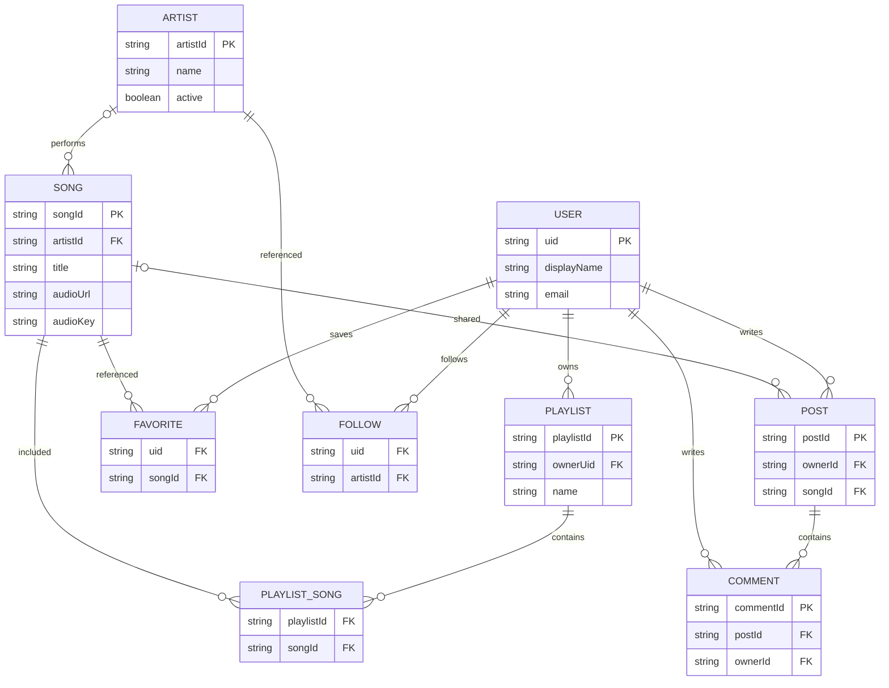

# Phân tích và thiết kế music_stream_app

## Hiện trạng và thay đổi

Các file gốc của music_stream_app có nhiều giao diện, nhưng login/register còn hành vi demo, dữ liệu bài hát mẫu và service chưa truy vấn Firestore. Bộ bàn giao này chuyển entry sang Expo Router tại src/app; triển khai service Firebase, AuthContext, DataContext, PlayerContext và Rules. Đây là bộ source thay thế để chạy riêng, không phải patch chỉ chép một màn hình vào App.tsx cũ.

## Yêu cầu chức năng

| Nhóm      | Yêu cầu                                                | Hiện thực                              |
| --------- | ------------------------------------------------------ | -------------------------------------- |
| Tài khoản | Đăng ký/đăng nhập/đăng xuất/reset password             | Firebase Auth Email/Password           |
| Hồ sơ     | Xem/sửa tên và URL ảnh                                 | Auth profile + users document          |
| Danh mục  | Xem/tìm bài và nghệ sĩ, lời nhạc                       | Firestore realtime + lọc tên không dấu |
| Admin     | Thêm/sửa/ẩn bài, xóa bài, thêm/sửa/ẩn nghệ sĩ          | Custom claim + schema Rules            |
| Thư viện  | CRUD playlist, thêm/gỡ bài                             | Mảng songIds, arrayUnion/arrayRemove   |
| Cá nhân   | Bật/tắt yêu thích và theo dõi                          | Private subcollections của user        |
| Phát nhạc | Player/MiniPlayer đồng bộ, seek, next/previous, repeat | Một expo-audio player dùng chung       |
| Cộng đồng | Tạo/sửa/ẩn post, tạo/sửa/xóa comment                   | Posts và comments, kiểm tra owner      |

Yêu cầu phi chức năng: TypeScript strict, phân quyền phía server, không chứa Admin SDK trong app, HTTPS cho media, unsubscribe listener khi đổi tài khoản, thông báo lỗi/loading. Hạn mức đang dùng và phần chưa triển khai có trong START_HERE.md. Chưa có số liệu hiệu năng/SLA để tuyên bố đáp ứng production scale.

## Các tầng mã nguồn

| Thư mục               | Trách nhiệm                                                |
| --------------------- | ---------------------------------------------------------- |
| src/app               | Route Expo Router và Guard                                 |
| src/screens           | Giao diện, gọi service/context; không giữ database riêng   |
| src/components        | Form, Artwork, SongRow, MiniPlayer/navigation              |
| src/contexts          | Phiên Auth, dữ liệu realtime cá nhân/danh mục, một player  |
| src/services/firebase | Khởi tạo app/Auth/Firestore; Auth native dùng AsyncStorage |
| src/services          | Auth, catalog, library và feed CRUD                        |
| src/utils             | Validation, chuẩn hóa tìm kiếm, thông báo lỗi              |
| tools                 | Admin scripts trên máy quản trị, không import vào src      |
| tests                 | Validation tests và Rules tests với emulator               |

App gọi trực tiếp Firebase JavaScript SDK. Firebase Auth xác thực và cấp ID token; Firestore đánh giá Security Rules khi client đọc/ghi. Không có REST server tự viết, Spring Boot hoặc cơ sở dữ liệu SQL.

## Schema Firestore

| Đường dẫn                           | Field chính                                                                          | Khóa/quan hệ                                   |
| ----------------------------------- | ------------------------------------------------------------------------------------ | ---------------------------------------------- |
| users/{uid}                         | displayName,email,photoURL,createdAt                                                 | uid bằng Firebase Auth UID                     |
| artists/{artistId}                  | name,imageUrl,biography,active                                                       | Khóa document                                  |
| songs/{songId}                      | title,artist,artistId,album,coverUrl,audioUrl,audioKey,durationSeconds,lyrics,active | artistId tham chiếu artists; có thể rỗng       |
| users/{uid}/playlists/{id}          | name,description,songIds[]                                                           | Owner theo đường dẫn; songIds tham chiếu songs |
| users/{uid}/favorites/{songId}      | songId                                                                               | Document ID bằng songId, ngăn trùng            |
| users/{uid}/following/{artistId}    | artistId                                                                             | Document ID bằng artistId                      |
| posts/{postId}                      | ownerId,authorName,content,songId,active,createdAt                                   | ownerId tham chiếu Auth user; songId tùy chọn  |
| posts/{postId}/comments/{commentId} | ownerId,authorName,content,createdAt                                                 | Parent là post, ownerId là tác giả             |

artist trong song và authorName trong post/comment là tên snapshot/denormalized; không phải khóa ngoại. Giao diện danh mục ưu tiên tên artist hiện tại theo artistId. createdAt dùng Firestore timestamp; các trường ID dùng string. Không có collection albums: album hiện chỉ là nhãn string. File nhạc/ảnh nằm ngoài Firestore.

## ERD logic cho báo cáo

**Đây là ERD logic, không phải schema SQL.** PLAYLIST_SONG là thực thể nối để mô tả quan hệ nhiều–nhiều trong báo cáo; source lưu quan hệ này bằng mảng songIds trong playlist, không tạo collection PLAYLIST_SONG. ownerUid/postId có thể được suy ra từ đường dẫn subcollection. PK/FK trong ERD mô tả vai trò ID; Firestore không tự tạo ràng buộc FK hoặc cascade delete như SQL.

Rules kiểm tra bài/nghệ sĩ tồn tại khi thêm một số liên kết. Favorites/following chỉ tạo với đối tượng active. Thêm playlist bắt đầu mảng rỗng, update cho phép thêm tối đa một ID hợp lệ mỗi lần; có thể gỡ nhiều ID. Xóa bài vĩnh viễn không tự xóa mọi favorite/playlist; UI bỏ qua bài thiếu và cho gỡ ID cũ ở playlist. Production cần quy trình dọn dữ liệu nếu sử dụng hard delete thường xuyên.

## Phân quyền

| Dữ liệu                 | Read                              | Write                                      |
| ----------------------- | --------------------------------- | ------------------------------------------ |
| Songs/artists           | Công khai                         | Admin có claim admin=true, schema hợp lệ   |
| Hồ sơ và thư viện riêng | Chính UID sở hữu                  | Chính UID sở hữu, fields giới hạn          |
| Posts                   | Người đăng nhập, bao gồm archived | Tạo chính mình; sửa/ẩn owner hoặc admin    |
| Comments                | Người đăng nhập khi post active   | Tạo chính mình; owner sửa; owner/admin xóa |

Quyền admin do trusted Admin SDK cấp; không có màn hình tự cấp admin. Guard chỉ phục vụ UI; Rules là nơi chặn request giả mạo. Admin không tự động có quyền đọc thư viện riêng của người khác. Xóa tài khoản, cascade cleanup, đăng nhập mạng xã hội và xác minh email bắt buộc chưa triển khai.

## Luồng đăng nhập và CRUD

Đăng nhập thành công → AuthContext nhận user/token → nạp claim → DataContext mở listeners đúng UID → các màn hình dùng cùng dữ liệu. Đổi UID làm mới DataSession và PlayerSession, tránh giữ thư viện/âm thanh của phiên trước.

Ví dụ tạo playlist: form kiểm tra tên → addDoc users/UID/playlists với songIds=[] → Rules kiểm tra UID/schema → snapshot cập nhật DataContext → UI hiển thị playlist. Thêm bài sử dụng arrayUnion để tránh ghi đè thay đổi đồng thời.

Ví dụ phát nhạc: SongRow truyền song + queue → PlayerContext chọn audioUrl hoặc bundled audioKey → expo-audio cập nhật trạng thái → Player/MiniPlayer cùng đọc position/playing/duration. Thời lượng Firestore là metadata; progress phát dùng thời lượng thực từ player.

## Vận hành và báo cáo

1. Requirements: đối chiếu bảng yêu cầu với chức năng môn học; ghi riêng mục ngoài phạm vi.
2. Design: dùng schema, ERD logic và phân quyền trên; không mô tả Firestore như SQL.
3. Implementation: chụp các màn hình thật, tên collection và vài document mẫu; che dữ liệu cá nhân.
4. Testing: chạy tests, sau đó hoàn thành checklist thiết bị/Firebase thật trong TEST_REPORT.md.
5. Delivery: chỉ nộp source/lockfile/tài liệu; không nộp .env thật, service account, node_modules.
6. Maintenance: theo dõi lỗi, hạn mức reads/writes, kiểm tra Rules trước khi đổi query/schema; bổ sung phân trang và cleanup dữ liệu khi mở rộng.

Tham khảo chính thức: https://firebase.google.com/docs/firestore/security/get-started ; https://firebase.google.com/docs/auth/admin/custom-claims ; https://docs.expo.dev/router/installation/ ; https://docs.expo.dev/versions/v58.0.0/sdk/audio/ .
